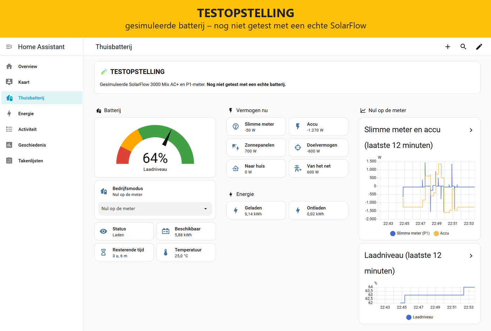
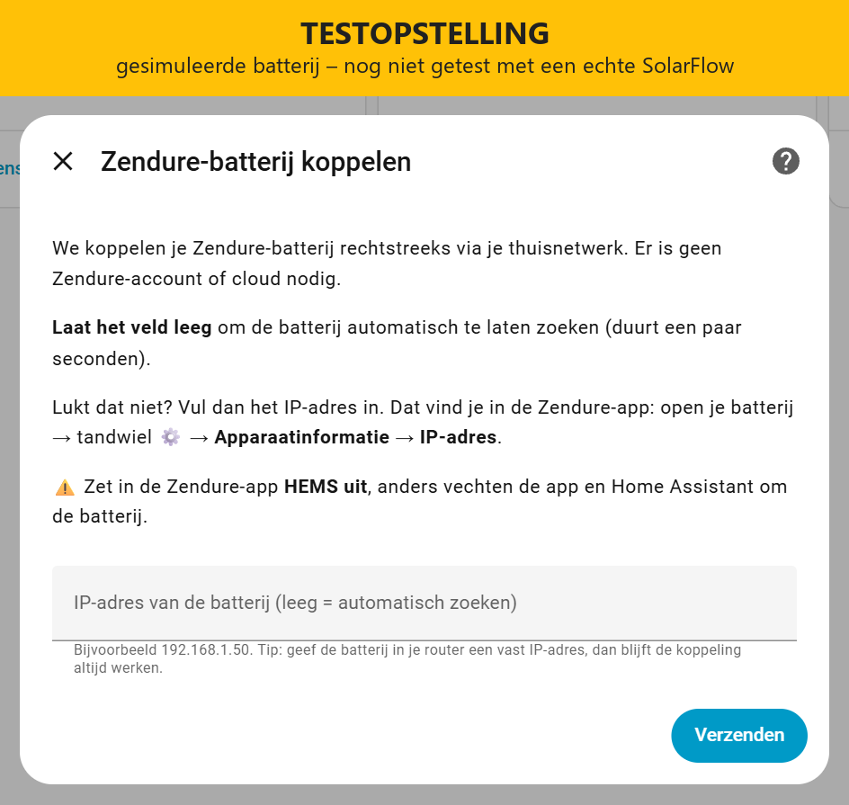
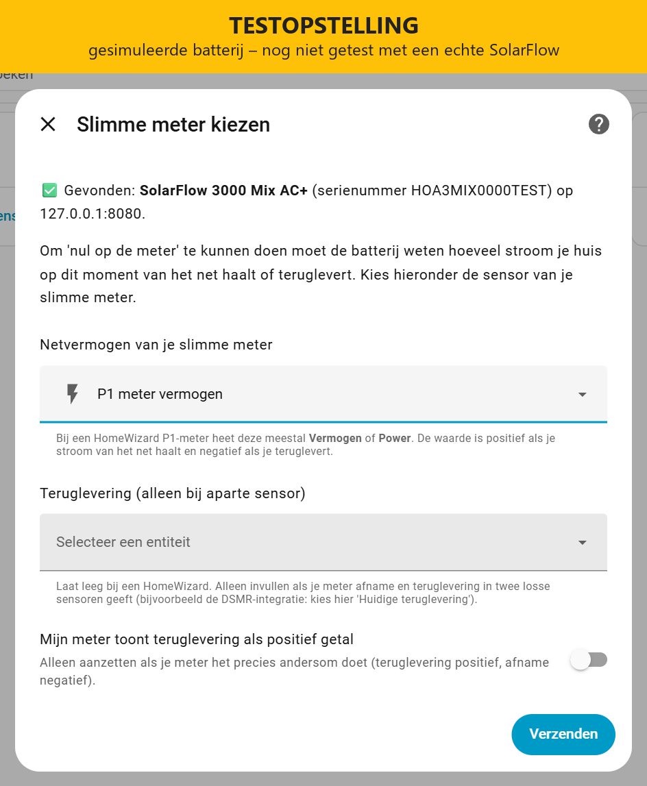
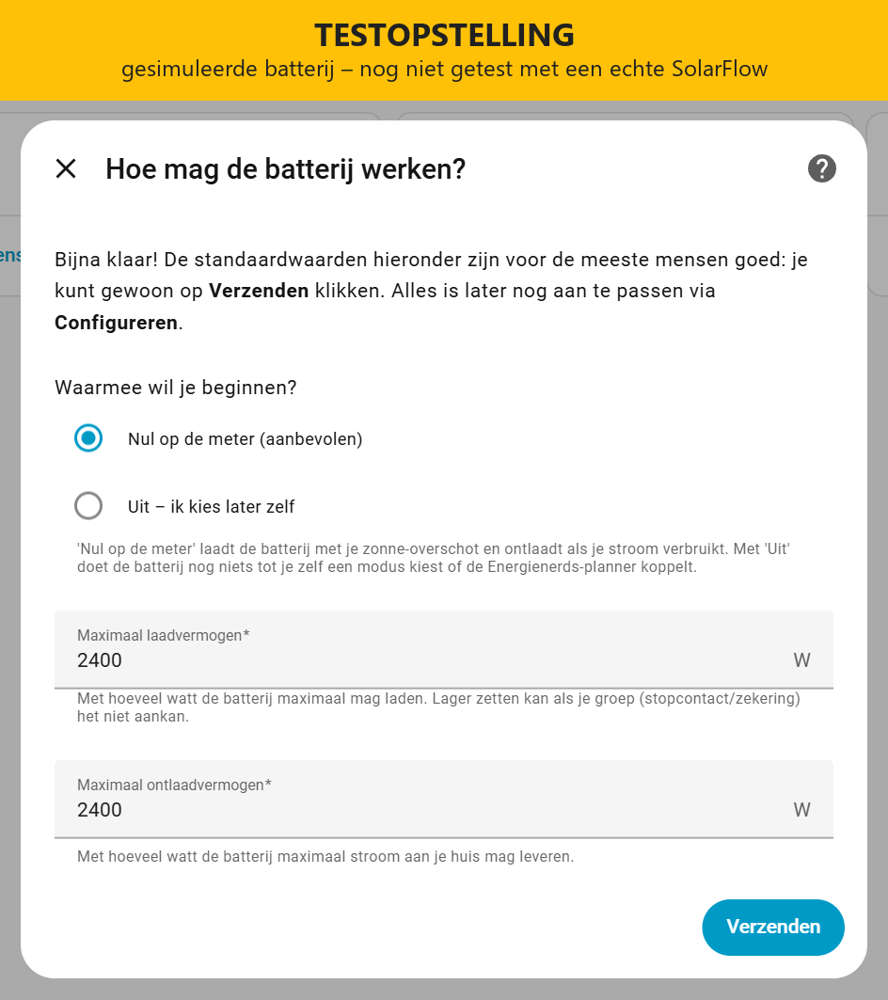
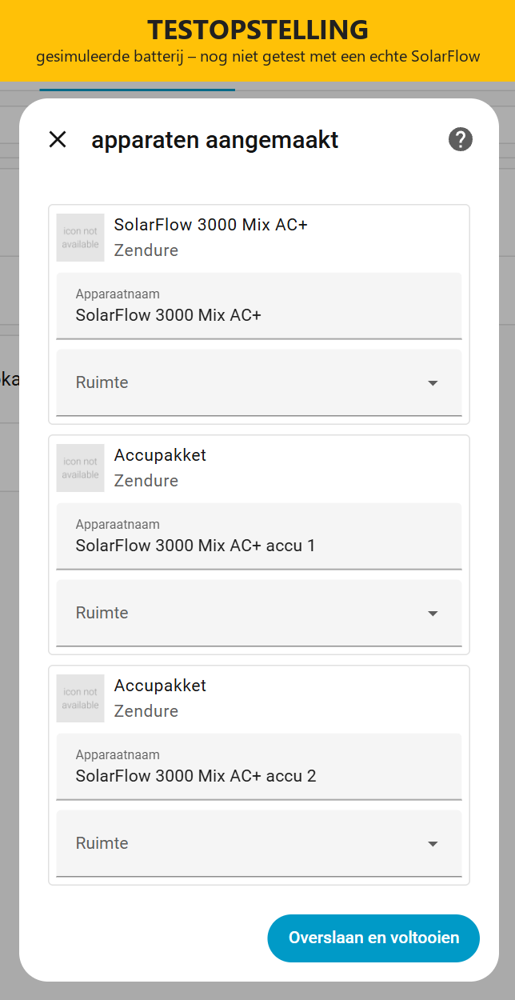
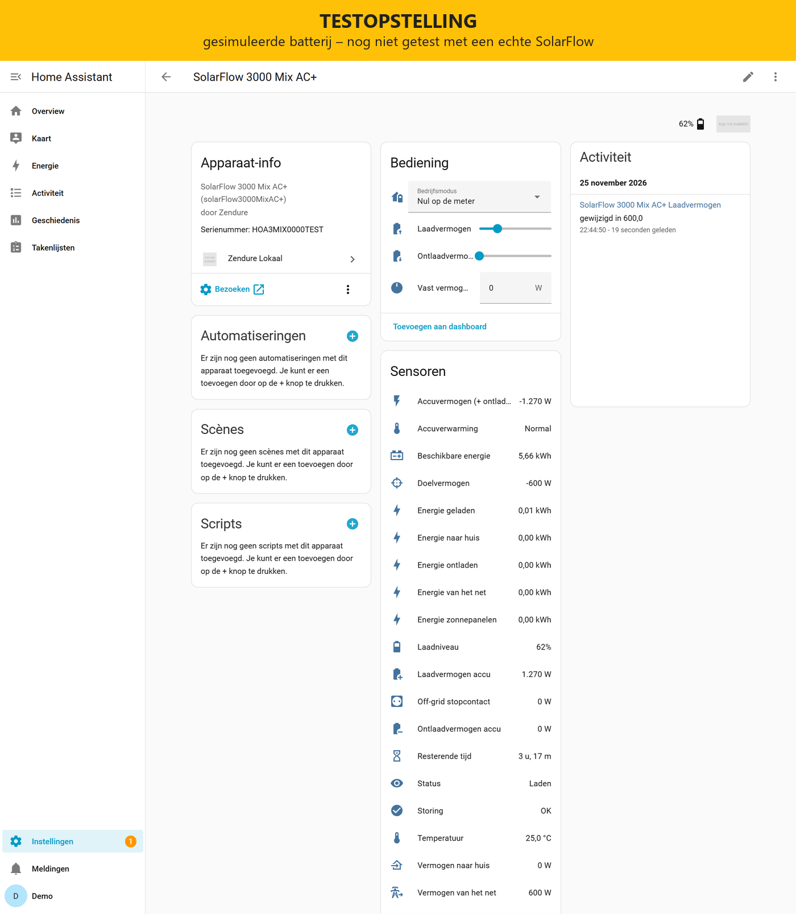
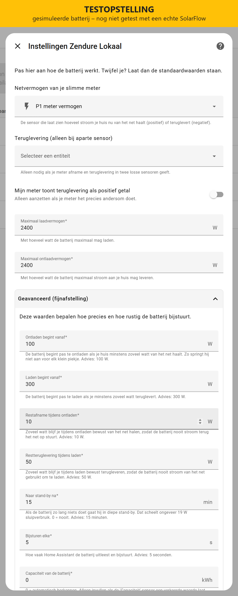

# Zendure Lokaal

Je Zendure-thuisbatterij **100% lokaal** in Home Assistant, ingesteld met een paar klikken.
Er is geen Zendure-account, geen cloud, geen YAML en geen automatisering nodig.
Werkt direct samen met de **planner van [Energienerds.nl](https://energienerds.nl/)**.

Gemaakt voor de **SolarFlow 3000 Mix AC+**. Omdat de lokale API (zenSDK) hetzelfde is, zou hij ook moeten werken met
de SolarFlow 4000 Mix, 2400 AC / AC+ / Pro, 1600 AC+ en 800 Pro / Plus.

> 🧪 **Testversie.** Alles is getest in een testopstelling met een **gesimuleerde** SolarFlow 3000 Mix AC+ en P1-meter
> (54 automatische tests en een echte Home Assistant). Met een **echte batterij is hij nog niet getest.**
> Probeer je hem uit? Kijk de eerste keer even mee, en laat je ervaring achter via
> [Issues](https://github.com/Nightdrix/zendure-lokaal/issues).


<sub>*Voorbeeld-dashboard in de testopstelling met een gesimuleerde batterij. Meer schermen staan onder [Zo ziet het eruit](#zo-ziet-het-eruit).*</sub>

## Waarom dit pakket?

Ik wilde dat ook een **SolarFlow 3000 Mix AC+** lokaal samenwerkt met de planner van Energienerds, en dat iedereen hem kan
instellen, ook zonder technische kennis. Dus geen YAML-bestanden, geen `configuration.yaml` en geen automatiseringen
plakken: alles gaat via het gewone instelscherm van Home Assistant, met uitleg in begrijpelijk Nederlands.

## Voordelen

- **In een paar minuten klaar**: installeren via HACS, daarna drie schermen doorlopen.
- **Batterij wordt automatisch gevonden** op je netwerk. Je kunt ook zelf het IP-adres invullen, en dat wordt meteen gecontroleerd.
- **Eén instelscherm**, met bij elke instelling uitleg en een advieswaarde. De standaardwaarden werken voor de meeste mensen meteen.
- **Nul op de meter ingebouwd**. Er is geen losse automatisering nodig: de batterij laadt met je zonne-overschot en levert stroom als je huis verbruikt.
- **Werkt met de Energienerds-planner**. Eén knop koppelt de planner aan je batterij, en daarna stel je per uur in wat de batterij doet.
- **100% lokaal**: geen Zendure-account en geen cloud, en het werkt ook als het internet even weg is.
- **Veilig**: de batterij stopt als de slimme meter wegvalt, wordt stilgezet als Home Assistant herstart en gaat in stand-by als hij niets te doen heeft (bespaart ± 19 W).
- **Klaar voor het Energie-dashboard**, met energietellers voor laden, ontladen, het net en de zonnepanelen.
- **Updates via HACS**: je krijgt vanzelf een melding als er een nieuwe versie is.

## Gebaseerd op het werk van anderen

Dit pakket is niet uit het niets ontstaan. Het bouwt voort op:

- **[Zendure-HA-zenSDK van Gielz1986](https://github.com/Gielz1986/Zendure-HA-zenSDK)**. Daaruit komt de kennis hoe je een
  Zendure-batterij volledig lokaal via de zenSDK-API aanstuurt. Het gaat om:
  - welke instellingen je naar de batterij stuurt en hoe (`acMode`, `inputLimit`, `outputLimit`, `socSet`/`minSoc`, `gridReverse`);
  - het werkgeheugen-trucje (`smartMode`), zodat het flashgeheugen niet slijt;
  - de stand-by tegen sluipverbruik;
  - de noodstop als de P1-meter wegvalt;
  - de capaciteit per accupakket, ook voor de 3000 Mix;
  - de beproefde advieswaarden voor startdrempels en marges.

  Zonder dat werk was dit pakket er niet geweest.
- **[De officiële Zendure-integratie](https://github.com/Zendure/Zendure-HA)**. Daaruit komen de bedrijfsmodi en de opbouw van de
  knoppen (zodat de Energienerds-planner ermee werkt), het rekenprincipe van de nul-op-de-meter-regeling en het herkennen
  van accupakketten aan hun serienummer.
- **[De planner van Energienerds.nl](https://github.com/Mediacj/zendure-schedule)**: het dashboard waarmee je per uur plant.

Dit pakket voegt daar vooral **gebruiksgemak** aan toe: alles in één integratie, in te stellen via het scherm, met uitleg erbij.

---

## Zo ziet het eruit

> ⚠️ Alle schermafbeeldingen hieronder komen uit een **testopstelling**: een echte Home Assistant met een
> **gesimuleerde** SolarFlow 3000 Mix AC+ en P1-meter. Daardoor zie je bijvoorbeeld `127.0.0.1:8080` als adres
> en `HOA3MIX0000TEST` als serienummer. **Met een echte batterij is het pakket nog niet getest.**

**Stap 1 – Batterij koppelen.** Laat het veld leeg om automatisch te zoeken, of vul het IP-adres in.



**Stap 2 – Slimme meter kiezen.** Hij laat meteen zien welke batterij hij heeft gevonden.



**Stap 3 – Hoe mag de batterij werken?** De standaardwaarden zijn goed, dus je klikt gewoon op *Verzenden*.



**Klaar.** De batterij en de accupakketten verschijnen als apparaten.



<details>
<summary><b>Apparaatpagina</b>: alle knoppen en sensoren (testopstelling)</summary>


</details>

<details>
<summary><b>Configureren</b>: alle instellingen met uitleg (testopstelling)</summary>


</details>

---

## Wat heb je nodig?

- Home Assistant **2025.2 of nieuwer**
- Een Zendure-batterij met lokale API (zenSDK)
- Een slimme meter in Home Assistant, bij voorkeur een **HomeWizard P1**
- In de Zendure-app: **HEMS uitgeschakeld**

---

## Stap 0 – Zorg dat maar één systeem de batterij aanstuurt (belangrijk!)

Stuur je de batterij nu al op een andere manier aan vanuit Home Assistant, bijvoorbeeld met een eigen automatisering,
een YAML-pakket of een andere Zendure-integratie? Zet dat dan eerst uit:

1. Ga naar **Instellingen → Automatiseringen** en zet automatiseringen die de batterij aansturen uit.
2. Heb je een YAML-pakket voor je Zendure in de map `packages`? Haal dat bestand weg.
3. Gebruik je een andere Zendure-integratie? Zet de sturing daarvan uit, of verwijder de integratie.
4. Herstart Home Assistant.

> Tip: kaarten op je dashboard die de oude entiteiten gebruikten, vervang je door de planner-kaart (stap 3).

---

## Stap 1 – Installeren

### Manier A: via HACS (aanbevolen – je krijgt ook updates)

1. Klik op deze knop (op een apparaat waarop je Home Assistant kunt openen):

   [](https://my.home-assistant.io/redirect/hacs_repository/?owner=Nightdrix&repository=zendure-lokaal&category=integration)

   Werkt de knop niet? Open dan **HACS → ⋮ (rechtsboven) → Aangepaste repositories**, plak
   `https://github.com/Nightdrix/zendure-lokaal`, kies type **Integratie** en klik op **Toevoegen**.
2. Klik op **Downloaden** en daarna nog een keer op **Downloaden**.
3. Herstart Home Assistant (**Instellingen → Systeem → rechtsboven ⏻ → Home Assistant opnieuw opstarten**).

### Manier B: map kopiëren (zonder HACS)

1. Download `zendure_lokaal-x.x.x.zip` bij de nieuwste [release](https://github.com/Nightdrix/zendure-lokaal/releases/latest) en pak hem uit.
2. Installeer in Home Assistant de add-on **Samba share** (Instellingen → Add-ons → Add-on winkel), vul een gebruikersnaam en wachtwoord in en start hem.
3. Open op je Windows-pc de Verkenner en typ in de adresbalk: `\\homeassistant.local\config`
4. Open de map `custom_components`. Bestaat die nog niet? Maak hem dan aan.
5. Kopieer de uitgepakte map **`zendure_lokaal`** daarin.
   Je hebt dan: `config/custom_components/zendure_lokaal/manifest.json` (enz.)
6. Herstart Home Assistant.

---

## Stap 2 – Batterij koppelen

1. Ga naar **Instellingen → Apparaten & diensten → Integratie toevoegen** en zoek op **Zendure Lokaal**.
2. **IP-adres**: laat het veld leeg en klik op *Verzenden*. De batterij wordt dan automatisch gezocht.
   Wordt hij niet gevonden? Vul het IP-adres in. Dat staat in de Zendure-app onder je batterij → ⚙️ → *Apparaatinformatie*.
3. **Slimme meter**: kies de vermogenssensor van je P1-meter. Bij een HomeWizard heet die *Vermogen* of *Power*.
4. **Instellingen**: de standaardwaarden zijn goed, dus klik gewoon op *Verzenden*.

Klaar! De batterij doet nu **nul op de meter**: hij laadt met je zonne-overschot en levert stroom als je huis verbruikt.

💡 Tip: geef de batterij in je router een **vast IP-adres**. Krijgt hij toch een ander adres, ga dan naar
*Zendure Lokaal → ⋮ → Opnieuw configureren*.

---

## Stap 3 – Energienerds-planner (het dashboard)

Met de planner van Energienerds stel je per uur in wat de batterij moet doen, bijvoorbeeld *goedkoop laden*, *duur ontladen* of *nul op de meter*.

1. Installeer de planner via HACS:
   [](https://my.home-assistant.io/redirect/hacs_repository/?repository=zendure-schedule&category=integration&owner=Mediacj)
   Herstart daarna Home Assistant.
2. Ga naar **Instellingen → Apparaten & diensten → Zendure Lokaal** en open je batterij (het apparaat).
3. Klik onder *Configuratie* op **Koppel aan Energienerds-planner** → *Indrukken*.
   De planner wordt nu automatisch met de juiste knoppen ingesteld.
4. Open je dashboard → ✏️ (bewerken) → **Kaart toevoegen** → zoek op **schedule** → kies *Zendure Schedule*.
   Staat hij er niet tussen? Ververs de pagina met **Ctrl+F5**.

<details>
<summary>Liever handmatig koppelen? Dit vul je in bij de planner</summary>

| Veld in de planner | Kies deze entiteit van je batterij |
|---|---|
| Bedrijfsmodus | **Bedrijfsmodus** (`select.…_bedrijfsmodus`) |
| AC mode select (input/output) | **AC-modus** (`select.…_ac_modus`) |
| Laadvermogen (input_limit) | **Laadvermogen** (`number.…_laadvermogen`) |
| Ontlaadvermogen (output_limit) | **Ontlaadvermogen** (`number.…_ontlaadvermogen`) |
| Max SOC bij laden | **Maximaal laadniveau** (`number.…_maximaal_laadniveau`) |
| Min SOC bij ontladen | **Minimaal laadniveau** (`number.…_minimaal_laadniveau`) |

Alle andere velden kun je op de standaardwaarde laten staan.
</details>

---

## De bedrijfsmodi

Je kiest de modus zelf via **Bedrijfsmodus**, of de planner doet het per uur voor je.

| Modus | Wat doet de batterij? | Planner-knop |
|---|---|---|
| **Nul op de meter** | Laadt met overschot en ontlaadt bij verbruik, zodat je meter rond 0 W blijft | NOM |
| **Slim ontladen** | Alleen ontladen naar je verbruik, nooit laden | SLM-O |
| **Slim laden** | Alleen laden met overschot, nooit ontladen uit de accu | SLM-L |
| **Alleen zonne-energie opslaan** | Alleen laden met overschot en nooit stroom leveren | – |
| **Vast vermogen** | Laadt of ontlaadt met een vast vermogen (schuifje *Vast vermogen*) | – |
| **Uit** | Doet niets automatisch. Wordt door de planner gebruikt voor *Laden*, *Ontladen* en *Uit* | Laden / Ontladen / Uit |

### Veiligheid ingebouwd
- **P1-meter weg?** Na een minuut stopt de batterij en krijg je een melding. Werkt de meter weer, dan gaat hij vanzelf verder.
- **Home Assistant uit of herstart?** De batterij wordt eerst stilgezet, zodat hij niet blijft doorgaan met een oud vermogen.
- **15 minuten niets te doen?** Dan gaat de batterij in diepe stand-by. Dat bespaart ongeveer 19 W sluipverbruik.
- **HEMS per ongeluk aan?** Dan zie je een melding onder *Instellingen → Reparaties*.
- Alle snelle bijsturingen gaan naar het werkgeheugen van de batterij, dus zijn flashgeheugen slijt niet.

---

## Instellingen aanpassen

Ga naar **Instellingen → Apparaten & diensten → Zendure Lokaal → Configureren**. Daar vind je:

- je slimme meter en het maximale laad- en ontlaadvermogen;
- onder **Geavanceerd** de fijnafstelling. Elke instelling heeft uitleg en een advieswaarde:

| Instelling | Advies | Uitleg |
|---|---|---|
| Ontladen begint vanaf | 100 W | Pas ontladen als het huis minstens zoveel van het net haalt |
| Laden begint vanaf | 300 W | Pas laden als je minstens zoveel teruglevert |
| Restafname tijdens ontladen | 10 W | Voorkomt dat accu-stroom het net op gaat |
| Restteruglevering tijdens laden | 50 W | Voorkomt dat je met net-stroom laadt |
| Naar stand-by na | 15 min | 0 = nooit |
| Bijsturen elke | 5 s | Hoe vaak de batterij wordt bijgestuurd |
| Capaciteit | 0 | 0 = automatisch; alleen invullen als de sensor *Capaciteit* niet klopt |

---

## Wat zie je in Home Assistant?

Op de apparaatpagina van je batterij staan onder andere:

- **Laadniveau**, **Status** (Laden / Ontladen / Wacht / Stand-by / Vol / Leeg) en **Beschikbare energie**
- **Accuvermogen**, **Vermogen naar huis**, **Vermogen van het net**, **Zonnepanelen** (+ per ingang)
- **Doelvermogen**: wat de regeling op dit moment wil, en **Netvermogen (P1)**: wat de regeling van je meter leest
- **Energie geladen / ontladen / naar huis / van het net / zonnepanelen** voor het *Energie*-dashboard
- Per accupakket een eigen apparaat met laadniveau, temperatuur en celspanningsverschil

**Energie-dashboard** (*Instellingen → Dashboards → Energie*):
- *Thuisbatterij* → energie de batterij in: **Energie geladen**, energie de batterij uit: **Energie ontladen**
- *Zonnepanelen* → **Energie zonnepanelen** (alleen als er panelen op de batterij zitten)

### Voorbeeld-dashboard

Het dashboard van de schermafbeelding bovenaan kun je zelf overnemen. Je hebt er niets extra's voor nodig, alleen
standaardkaarten:

1. Ga naar **Instellingen → Dashboards → Dashboard toevoegen → Nieuw dashboard vanaf nul** en noem het *Thuisbatterij*.
2. Open het nieuwe dashboard → ✏️ (bewerken) → **⋮** → **Ruwe configuratie-editor**.
3. Plak de inhoud van [`dashboard_voorbeeld.yaml`](dashboard_voorbeeld.yaml) en klik op **Opslaan**.

Heet jouw batterij anders dan *SolarFlow 3000 Mix AC+*? Vervang dan in de tekst `solarflow_3000_mix_ac` door de naam
die jij ziet (Ctrl+H = zoeken en vervangen).

De **Energienerds-planner** (stap 3) zet je er gewoon als extra kaart bij.

---

## Problemen oplossen

| Probleem | Oplossing |
|---|---|
| *Geen batterij gevonden* | Vul het IP-adres handmatig in (Zendure-app → Apparaatinformatie). Staan Home Assistant en de batterij op hetzelfde netwerk? |
| *Kan de batterij niet bereiken* | Klopt het IP-adres? Geef de batterij een vast IP-adres in je router. |
| Status **Gestopt: geen P1-meter** | Je slimme meter geeft geen waarde. Controleer de P1-meter; de batterij gaat vanzelf verder. |
| Batterij doet rare dingen | Staat HEMS uit in de Zendure-app? Stuurt er echt niets anders de batterij aan (stap 0)? |
| Meer details nodig | Zendure Lokaal → ⋮ → **Diagnostische gegevens downloaden**, of zet extra logging aan (zie hieronder). |

```yaml
# configuration.yaml – extra logging
logger:
  default: warning
  logs:
    custom_components.zendure_lokaal: debug
```

---

## Voor de techneuten

- Praat via HTTP met de batterij: `GET /properties/report` en `POST /properties/write` (zenSDK).
- Bedrijfsmodi en entiteiten zijn bewust gelijk aan de officiële [Zendure-HA](https://github.com/Zendure/Zendure-HA)-integratie (`off`, `smart`, `smart_discharging`, `smart_charging`, `acMode`, `inputLimit`, `outputLimit`, `socSet`, `minSoc`), zodat de [Energienerds-planner](https://github.com/Mediacj/zendure-schedule) er zonder aanpassing mee werkt.
- De regeling: `vraag = P1 + (vermogen naar huis − vermogen van net)`. Met startdrempels en marges voorkom je pendelen.
- Testen zonder echte batterij: `tests/fake_zendure.py` simuleert een SolarFlow 3000 Mix AC+ (accu, panelen, huisverbruik, P1).

```powershell
pip install pytest-homeassistant-custom-component
pytest
```

Met dank aan [Gielz1986](https://github.com/Gielz1986/Zendure-HA-zenSDK), de makers van de [officiële Zendure-integratie](https://github.com/Zendure/Zendure-HA) en [Energienerds.nl](https://energienerds.nl/) (zie *Gebaseerd op het werk van anderen* bovenaan).
